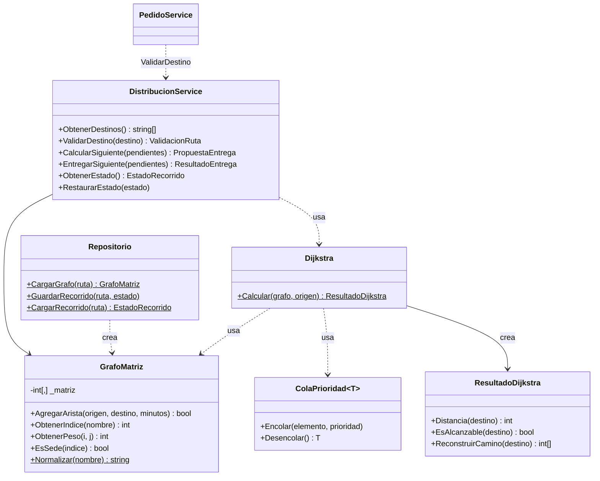

## Instituto Tecnológico de Costa Rica

## Proyecto 2 - ConviTEC

### Algoritmos y estructuras de datos I (CE1103)

---

#### Estudiantes

- Kevin Hernández Romero 
- Joshua Andrade Pérez 
- Josué Zamora Arce 
- Fabricio Coto Solano

#### Profesor

- Luis Barboza Artavia 

---

### Objetivo General

- Desarrollar en C# un sistema distribuido de inventario y entregas para cuatro sedes, usando estructuras de datos y algoritmos propios.

#### Objetivos Específicos

- Implementar en C# estructuras de datos propias, incluyendo un árbol jerárquico y un grafo ponderado.
- Aplicar Dijkstra en C# para calcular los recorridos de entrega y rechazar destinos inalcanzables.
- Coordinar las reservas entre sedes mediante mensajes y guardar los datos en archivos locales.

---

### Distribución y rutas

La red de entregas es un grafo no dirigido y ponderado (`GrafoMatriz`) guardado en una matriz de adyacencia. Cada vértice es una ubicación y cada arista una ruta con su tiempo en minutos. Se carga al iniciar desde `data/grafo.json`:

```json
[ { "origen": "Liberia (Sede)", "destino": "Cañas", "ruta": "R01", "tiempo": 65 } ]
```

También se acepta `{ "rutas": [ ... ] }`. Los nombres se comparan sin el sufijo `(Sede)`, sin tildes y sin mayúsculas, así que `"San José (Sede)"` y `"san jose"` son la misma ubicación.

**Recorrido de entregas.** El vehículo sale de la sede. En cada paso se corre Dijkstra desde la ubicación actual, se elige el destino pendiente más cercano, se entregan todos los pedidos de ese destino y se repite desde ahí. El recorrido termina cuando no quedan pendientes alcanzables, y la siguiente salida vuelve a partir de la sede. El estado del recorrido se guarda en `data/<sede>/recorrido.json`.

Un destino que no se puede alcanzar desde la sede se rechaza con una explicación. Por ejemplo, Guanacaste es un componente aislado: Liberia solo llega a Cañas.

| Endpoint | Descripción |
|---|---|
| `GET /api/destinos` | Puntos de entrega (todos menos la propia sede) |
| `GET /api/entregas/siguiente` | Próximo destino, tiempo, camino y pedidos, sin mover el vehículo |
| `POST /api/entregas/siguiente` | Entrega ese destino y devuelve el tiempo acumulado y si el recorrido terminó |


